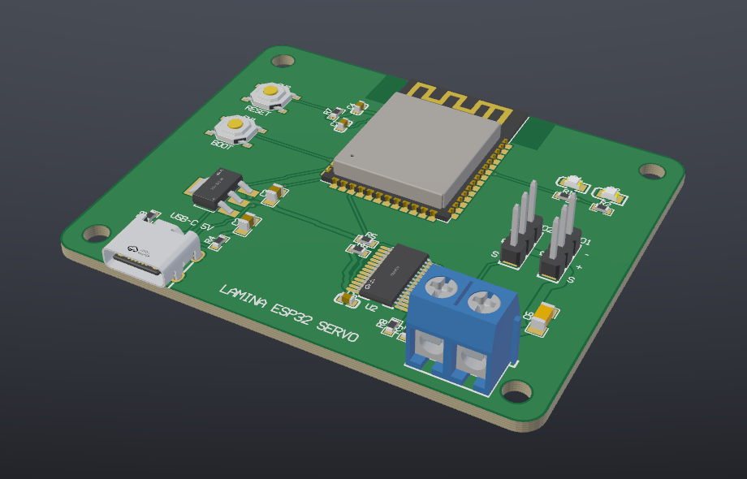
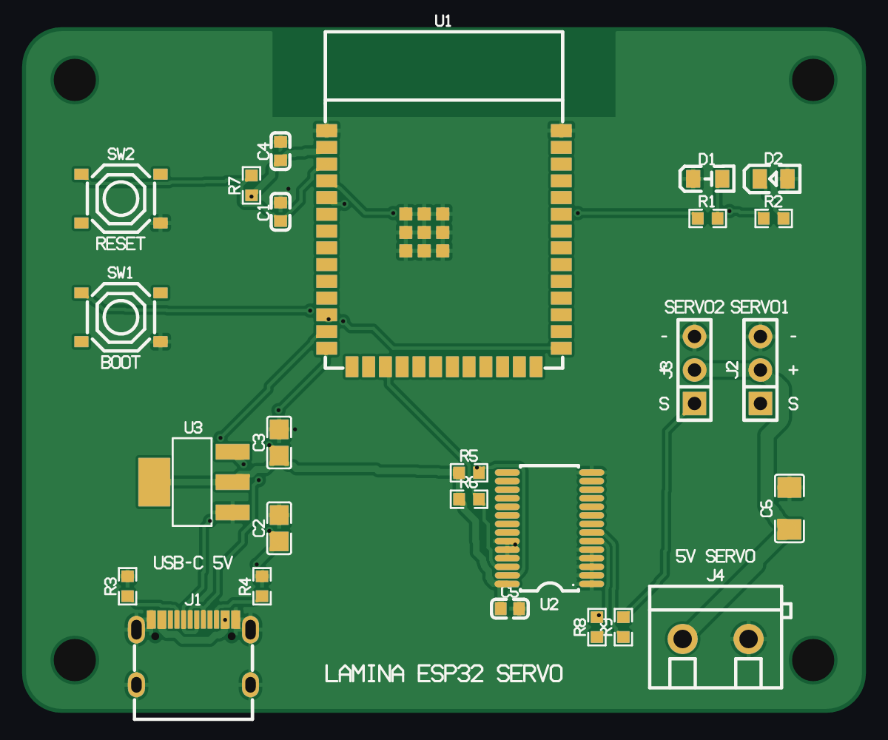
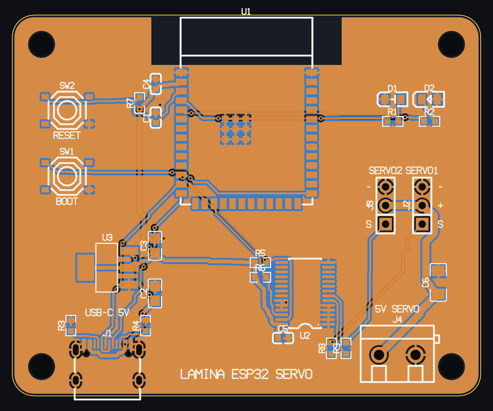

<p align="center"></p>

# Lamina

PCB layout for coding agents. A headless engine uses MCP over stdio. The
board is kept as plain JSON files in git. A separate viewer draws the board
again in 2D and 3D each time these files change.

Status: early development. The design is in `docs/specs/`.

<p align="center"></p>

<table>
<tr>
<td></td>
<td></td>
</tr>
<tr>
<td align="center">The finished board, top side</td>
<td align="center">Top and bottom copper, silkscreen and drills</td>
</tr>
</table>

The images show an ESP32-S3 servo board with 26 parts on 2 layers. A coding agent made this
board through the Lamina MCP tools. Lamina rendered each image with the `render` tool.

## Layout

| Crate | Purpose |
|---|---|
| `lamina-model` | Data types, JSON schema, project load and save |
| `lamina-geom` | Polygon operations and spatial index |
| `lamina-footprint` | IPC-7351 footprint generator, datasheet footprints |
| `lamina-parts` | LCSC / JLCPCB / EasyEDA part search and import |
| `lamina-step` | STEP reader and tessellator, OBJ loader, mesh cache |
| `lamina-drc` | Design rules, fab presets, DRC, connectivity |
| `lamina-route` | Interactive routing, zones, grid router |
| `lamina-export` | Gerber X2, Excellon, BOM, CPL, board STEP |
| `lamina-scene` | Draw list that the renderers share |
| `lamina-render` | PNG rendering, 2D and 3D |
| `lamina-build` | Jsonnet design sources, workspaces |
| `lamina-kicad` | KiCad footprint and board files in and out |
| `lamina-core` | Project operations, one function for each tool |
| `lamina-mcp` | The `lamina` binary: MCP server and CLI |
| `lamina-viewer` | Live 2D/3D viewer and editor |

`vendor/jrsonnet-stdlib` is the Jsonnet standard library without YAML and
wasm-bindgen. Their pinned versions are in conflict with egui and wgpu.

## Build

```
cargo build --release
```

## Use with an MCP client

```
claude mcp add --scope user lamina -- <path>/target/release/lamina mcp
```

Codex: add `[mcp_servers.lamina]` with `command = "<path>/target/release/lamina"` and `args = ["mcp"]` to `~/.codex/config.toml`.

A typical session:

1. `open` (create: true)
2. `use_fab_preset`
3. `set_outline`
4. `import_lcsc` for each part
5. `set_nets`
6. `place_many`
7. `autoroute`
8. `add_zone` for ground
9. `check`
10. `render`
11. `export`

To read the comments of the user, use `notes`.

## Viewer

```
lamina-viewer [--3d] [project folder or board file]...
```

The boards open side by side in one window. Each board has its own 2D or 3D
view. `--3d` starts in 3D. The layer panel, the inspector, the status bar and
the shortcuts apply to the board that you clicked last. To open a Lamina
project folder or a KiCad, EasyEDA or Gerber file, click `+` in the top bar or
push `Ctrl+O`. The viewer imports files from other programs in the background
into a project in the local data folder. When the source changes, it imports
them again. You can also drop folders and files on the window. If you give no
arguments, the viewer opens the boards that were open the last time.

The viewer watches the folders and draws the board again each time a file
changes. You edit the board as in KiCad:

- Click to select, drag to move, or drag a box to select.
- `R` rotate, `F` flip, `L` lock, `M` move, `Del` delete, arrow keys nudge.
- `X` route (`V` adds a via and changes the layer, `/` flips the bend).
- `V` via, `Z` pour, `K` keep-out, `O` outline.
- `D` measure (snaps to the centres of pads and vias).
- `N` grid, `Ctrl+Z` / `Ctrl+Y` undo and redo.
- `Ctrl+F` find a part, a value or a net.
- Right-drag or `Space`+drag pans, scroll zooms, `1` / `2` select 2D or 3D.
- `F1` shows a list of all shortcuts.

The Board menu autoroutes the full board or the nets of the selection (one
undo step). It also rips up tracks and exports fab files (Gerbers, drill, BOM,
CPL), a STEP assembly or a KiCad board. The inspector edits the values of the
selected item. The edits use the same engine as the tools, so an agent can
work on the board at the same time. Before each change, both sides read the
files again. The viewer saves the notes that you type in the side panel to
`notes.json` for the agent.

## Autorouter

`autoroute` (MCP), the Board menu of the viewer and `lamina-route` route all
open connections, or the nets that you name. No external program is
necessary:

- The router routes each net as a tree. The tree can start or end on any
  copper that already connects to the pads of the net, also pour pieces.
- The nets negotiate for space (PathFinder). At first, wires of different
  nets can overlap. Each pass increases the cost of cells that more than one
  net uses. The router routes the overlapping nets again until no nets
  overlap.
- If a connection fails at the width of its class, the router tries it at
  the minimum width. To repair a connection that still fails, the router
  removes the wires near it. Then it routes that area again on a grid that
  is two times finer.
- The router routes nets with a pour last. After it routes, it fills the
  pours again and routes the connections that the pours leave open.
- The router obeys keep-outs, via keep-outs, hole-to-hole spacing, the widths
  and clearances of net classes, and copper on layers that it must not use.

The test used two real KiCad boards with all tracks removed (the pours were
kept). The router completed 58 of 58 and 94 of 94 connections in
about 12 seconds for each board, with no DRC errors. This included
a USB-C D+/D- crossing between 0.5 mm pads.
`cargo run --release -p lamina-route --example bench -- <project>` does
the same measurement on any board.

## Modular boards

A board can come from `design.jsonnet`, not from JSON that you write by
hand. Jsonnet is JSON plus variables, functions and `import`. So parts,
nets and the board outline can come from blocks that you use again:

```jsonnet
local lamina = import 'lamina.libsonnet';
local servo = import 'servo.libsonnet';
lamina.merge([
  { board: { name: 'demo', outline: lamina.rect(64, 52, 3), rules: { preset: 'jlcpcb-2layer' } } },
  servo.channel('J2', 'R8', { pwm: 'PWM0', out: 'SERVO1', vservo: 'VSERVO', gnd: 'GND' }),
  servo.channel('J3', 'R9', { pwm: 'PWM1', out: 'SERVO2', vservo: 'VSERVO', gnd: 'GND' }),
])
```

`lamina build <board>` writes `board.json`, `parts.json` and `nets.json`.
When the source or an imported file changes, the MCP server and the viewer
build the board again automatically. They refuse direct edits to the
generated files. Placement and routing stay plain JSON, and you edit them as
usual. `lamina.libsonnet` is built in. It gives:

- `merge` joins fragments. Each part must be unique, and nets with the same
  name join their pads.
- `group` puts a tag on a block instance.
- `net`, `pads`, `rect`, `hole` and `corner_holes`.

Many boards can share blocks through a workspace. `lamina workspace <dir>`
writes `lamina.json` with `boards` and `lib` folders. Each lib folder is an
import path and can contain shared `footprints/` and `models/`.
`lamina new <dir> --modular` starts a board from a source template.

## Use a block layout again

Put each instance of a block in a group. Lay out one of the instances. Then
copy that layout to the other instances:

```jsonnet
lamina.group('servo1', servo.channel('J2', 'R8', { pwm: 'PWM0', out: 'SERVO1', vservo: 'VSERVO', gnd: 'GND' })),
lamina.group('servo2', servo.channel('J3', 'R9', { pwm: 'PWM1', out: 'SERVO2', vservo: 'VSERVO', gnd: 'GND' })),
```

```
lamina repeat-layout boards/servo --from servo1 --to servo2 --anchor J3
```

Lamina pairs the parts by footprint and wiring, not by name. A footprint
from a different library also pairs if its pads are at the same positions.
This is also true if its pads have the opposite numbers or its origin is on
pin 1. Lamina turns or moves the part to put its pads in the correct
positions. The anchor part does not move, and Lamina puts the other parts
of the block around it.

Lamina also copies the routing:

- All tracks and vias of a net that is fully in the block.
- Fan-outs to a via near the parts, on nets that go out of the block.

Lamina does not change the routes to the other parts of the board. Look
at the ratsnest after the copy. You can also give a block as a refdes list
(`--from D1,R1`).

`lamina save-layout <board> --from led1 --name led_indicator` writes the
layout to `layouts/led_indicator.json` in the workspace library.
`lamina place-layout <board> --name led_indicator --to led2` puts it on a
block of any board in the workspace. MCP: `repeat_layout`, `save_layout_block`,
`place_layout_block`. In the viewer, when you select a part of a group, these
commands are available: *Select group*, *layout like* a different group (the
selected part does not move) and *Copy layout to all like it*.

## KiCad files

Lamina reads and writes the KiCad formats without KiCad:

- `import_kicad_footprint` accepts `Library:Name` (for example
  `Package_TO_SOT_SMD:SOT-23`), a footprint name from a local library, or a
  `.kicad_mod` file. Lamina finds local libraries from `kicad_footprints` in
  `lamina.json`, from `KICAD*_FOOTPRINT_DIR` or from a standard install. If
  there is no local library, Lamina downloads the footprint and its STEP
  model from the official KiCad libraries. `search_kicad_footprints` searches
  the local libraries.
- `import_kicad_board` / `lamina import-kicad <file> <dir>` read a
  `.kicad_pcb` (KiCad 6 to 10): outline, footprints, parts, nets, placement,
  tracks, vias, zones, keep-outs and texts. The design rules and net classes
  come from the `.kicad_pro` file next to the board. If a footprint has more
  than one 3D model, Lamina uses the first model that it finds. Lamina looks
  for `${KIPRJMOD}` paths next to the board. `--online` downloads the other
  models from the official libraries.
- `export_kicad` / `lamina export-kicad <dir>` write a `.kicad_pcb` that
  KiCad 8 or a newer version can open. KiCad fills the zones again.

## EasyEDA boards

`import_easyeda_board` / `lamina import-easyeda <file.json> <dir>` read a
board that you saved from the standard EasyEDA editor with File → Export →
EasyEDA: outline, parts with their LCSC numbers, nets, placement, tracks,
vias, copper areas, holes and texts. Lamina downloads the 3D models from
EasyEDA, as for LCSC imports. Solid copper regions (teardrops, copper drawn
by hand) stay as drawings. Lamina relaxes the rules to what the board
contains. After the import, apply a fab preset.

## Gerbers from any CAD program

`import_gerbers` / `lamina import-gerbers <folder or zip> <dir>` read Gerber
files (RS-274X with X2 attributes, aperture macros, arcs, regions, step and
repeat) and Excellon drill files from any program. Lamina identifies the
layers by their X2 file function or by usual names (KiCad, Altium/Protel,
EasyEDA, Eagle). Fab files have no parts or nets, so the board comes in as
artwork: outline, holes, and copper and silkscreen as drawings. Use it to
look at the board, to render it and to compare it with the original.

## STEP for mechanical CAD

`export_step` / `lamina export-step <dir>` write the assembled board as an
AP214 STEP file. The board is a solid (outline, cut-outs, drilled holes;
`vias` adds the via holes), and each part is an assembly component at its
placement. Lamina copies the part STEP files fully, so their exact
surfaces, colours and names stay the same. Models that are only OBJ go in as
faceted surfaces. Fusion, FreeCAD, SolidWorks and other CAD programs can open
the file for enclosure work.

## External autorouters

The built-in router is the default. For a comparison, or if you prefer a
different router, `export_specctra` / `lamina export-dsn <dir>` write a
Specctra DSN of the board. `import_specctra_session` / `lamina import-ses
<file.ses> <dir>` read the session back. With
[Freerouting](https://github.com/freerouting/freerouting):

```
lamina export-dsn boards/servo
java -jar freerouting.jar -de boards/servo/output/esp32-servo.dsn -do boards/servo/output/esp32-servo.ses
lamina import-ses boards/servo/output/esp32-servo.ses boards/servo
```

Lamina exports the existing tracks as protected wiring. If you set
`reroute_all`, it does not export them.

## Tools

`lamina-export` has `outline <file.gbr> [tolerance]`. It prints the closed
loops that it finds in a Gerber outline layer. `lamina-step` has two
developer examples. `corpus <dir>` loads all STEP files in a folder and
compares each file with the OBJ file that has the same name. `meshview
<model> <out.png>` in `lamina-render` renders one model.

## Licence

MIT OR Apache-2.0.
